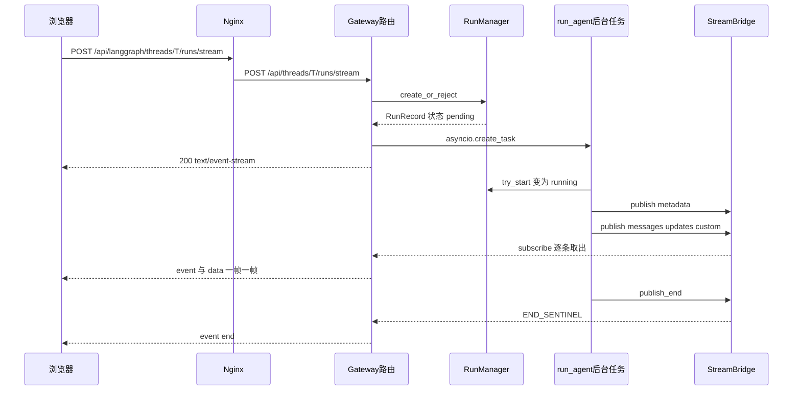

# 一次对话的完整旅程：从点击“发送”到文字一个个蹦出来

> 这是全书的“主干线”。你在聊天框里按下回车之后，到屏幕上一个字一个字蹦出来之前，请求一共路过了 **10 个站点**。
> 把这条线读通，后面所有章节（中间件、工具、沙箱、记忆……）你都知道它们“挂”在哪个位置。

## 本章你将学到

- 一条消息从浏览器出发，依次经过哪些进程、哪些文件、哪些函数，最后又怎样“流”回浏览器。
- **Thread（会话线程）/ Run（一次运行）/ Checkpoint（检查点）** 这三个最核心的名词在这条链路上分别出现在哪一步。
- 为什么 DeerFlow 要在“Agent 干活的线程”和“给浏览器推数据的连接”之间放一个 **StreamBridge（流桥）**。
- SSE（服务端推送事件）一帧一帧长什么样，浏览器断线后怎么“接着看”。
- 用户点“停止”、同一个会话连发两条消息、网关重启……这些边界情况在代码里是怎么兜住的。

## 先用一句大白话讲清楚

想象你在一家**点菜后厨现炒、边炒边上菜**的餐馆吃饭：

| 餐馆里的角色 | 在 DeerFlow 里对应 | 干什么 |
| --- | --- | --- |
| 你（点菜的人） | 浏览器里的前端（`useStream`） | 下单，然后盯着出菜口 |
| 门口导引员 | Nginx（端口 `2026`） | 告诉你“点菜走左边那扇门”，并且保证出菜口不被堵住 |
| 前台收银员 | Gateway（FastAPI，端口 `8001`） | 验身份、查订单合法性、登记订单号 |
| 订单本 | `RunManager` | 记录每一单（Run）当前是“排队 / 正在炒 / 炒完了 / 炒糊了” |
| 后厨大厨 | `run_agent` + 主智能体（Lead Agent） | 真正“炒菜”的人，边炒边把成品递到出菜口 |
| **传菜窗口** | **StreamBridge（流桥）** | 大厨把菜放窗口，服务员从窗口取走；两边互不等待 |
| 服务员 | `sse_consumer` | 不停地从传菜窗口取菜，一道一道端到你的桌上 |

最关键的设计就是“传菜窗口”：**大厨（Agent 工作线程）只管往窗口放，服务员（HTTP 连接）只管从窗口拿**。
所以即使你中途换了个座位（网络断了又重连），大厨也不会停，服务员还能从你吃到哪里继续端。

## 1. 先看全景图

```text
站点 0  浏览器（Next.js 前端 + LangGraph SDK 的 useStream）
          │  POST /api/langgraph/threads/{thread_id}/runs/stream
          ▼
站点 1  Nginx :2026
          │  把 /api/langgraph/* 改写成 /api/*，并关闭缓冲（为了让流式数据立刻出去）
          │  POST /api/threads/{thread_id}/runs/stream
          ▼
站点 2  Gateway 的“安检门”
          │  TraceMiddleware → (CORS) → CSRFMiddleware → AuthMiddleware → @require_permission
          ▼
站点 3  路由函数 stream_run（routers/thread_runs.py）
          │  调 start_run(...)，然后返回 StreamingResponse(sse_consumer(...))
          ▼
站点 4  start_run（gateway/services.py）
          │  校验 → 组装配置 → RunManager.create_or_reject → asyncio.create_task(后台任务)
          ▼
站点 5  RunManager（runtime/runs/manager.py）            ┐
          │  登记 RunRecord，状态 pending                    │ 后台任务另起一条“流水线”：
          │                                                  ▼
站点 6                                        run_agent（runtime/runs/worker.py）
                                                │  try_start → running → 组装 Agent → agent.astream(...)
                                                │  每产出一个片段就 publish 一次
                                                ▼
站点 7                                        StreamBridge.publish(run_id, event, data)   ← 事件通道
          ▲                                                  
          │  subscribe(run_id)  逐条取出                      
站点 8  sse_consumer（仍在站点 3 的那个 HTTP 请求里运行）
          │  format_sse(...) 把事件变成 "event: xxx\ndata: {...}\n\n" 文本
          ▼
站点 9  浏览器：useStream 收到 metadata / messages / updates / custom / end → React 更新界面
```

**读图要点**：从站点 4 开始，请求“分叉”成了两条路——

1. **前台这条（HTTP 请求协程）**：`stream_run` 马上返回一个 `StreamingResponse`，由 `sse_consumer` 不停地从 StreamBridge 里取事件写给浏览器。
2. **后厨这条（后台 asyncio 任务）**：`run_agent` 驱动 Agent 干活，把产出一条条放进 StreamBridge。

两条路只通过 StreamBridge 里的“事件日志”联系。下面一站一站讲。

一张时序图帮你把这两条路对上号（下面有文字版说明，看不到图也没关系）：



文字版：浏览器发请求 → Nginx 改写路径 → 网关路由先登记一个 Run 并启动后台任务，**同时**立刻回给浏览器一个 `200` 的流式响应 →
后台任务把产出不断放进 StreamBridge，网关这边的 `sse_consumer` 不断取出并写给浏览器 → 后台任务结束时发一个“结束”标记，`sse_consumer` 随即发出 `end` 帧并收尾。

## 2. 站点 0：浏览器里发生了什么

### 2.1 入口：`sendMessage` → `thread.submit`

前端聊天的核心 Hook 是 `useThreadStream`，它在 [`frontend/src/core/threads/hooks.ts`](../../frontend/src/core/threads/hooks.ts) 里，内部用的是 LangGraph 官方 SDK 提供的 `useStream`：

> 来源：[`frontend/src/core/threads/hooks.ts`](../../frontend/src/core/threads/hooks.ts) → `useThreadStream`

```typescript
  const thread = useStream<AgentThreadState>({
    client: getAPIClient(isMock),
    assistantId,
    threadId: onStreamThreadId,
    reconnectOnMount: true,
    fetchStateHistory: { limit: 1 },
```

你可以把 `useStream` 理解成“**别人写好的聊天流式收发工具**”：你给它一个 `client`（怎么连后端）和 `threadId`，它负责发请求、解析 SSE、把消息合并成 React 状态。DeerFlow 的网关刻意做成“**兼容 LangGraph Platform 协议**”，就是为了能直接用这个现成的 SDK，而不用前端自己造轮子。

用户点“发送”后，`sendMessage` 最终调用 `thread.submit(...)`：

> 来源：[`frontend/src/core/threads/hooks.ts`](../../frontend/src/core/threads/hooks.ts) → `sendMessage`

```typescript
        await thread.submit(
          {
            messages: buildThreadSubmitMessages({
              text,
              additionalKwargs: options?.additionalKwargs,
              additionalInputMessages: options?.additionalInputMessages,
              filesForSubmit: uploadedFiles,
              humanMessageId,
            }),
          },
          {
            threadId: threadId,
            // No streamSubgraphs: subtask progress arrives via root-namespace
            // custom events, while subgraph frames would leak a delegated
            // subagent's values/messages into the thread view (#4399).
            streamResumable: true,
            config: {
              recursion_limit: 1000,
            },
            context: buildRunContext({
              settings: context,
              threadId,
              extraContext,
              conversationReferences: options?.conversationReferences,
            }),
          },
        );
```

**逐段解释**：

1. 第一个参数是“**图的输入**”（graph input）：`{ messages: [...] }`，也就是你这次说的话（含已上传文件的信息）。
2. 第二个参数里的 `threadId` 告诉后端“这是哪个会话”；`config.recursion_limit: 1000` 是 LangGraph 的递归上限（Agent 来回“想一步、调一次工具”的最大步数）。
3. `context` 是 DeerFlow 自己的“**本次运行偏好**”，由 `buildRunContext` 生成——下一小节细讲。
4. 注释里提到“不传 `streamSubgraphs`”：子智能体（subagent）的进度走 `custom` 事件，如果把子图的帧也流给前端，会把子智能体的内部消息“漏”到主线程视图里（对应 issue #4399）。

> **小贴士**：新对话的第一次发送之前，线程必须先存在。LangGraph SDK 会先建线程（对应后端 `POST /api/threads`）；在“项目内新对话”场景，前端会用 `core/threads/api.ts` 的 `createThread` 预先创建。这就是为什么后面 `stream_run` 的权限装饰器可以写 `require_existing=True`。

### 2.2 `context`：把 UI 上的“模式”翻译成后端开关

聊天框里有“模式”选择（代码里 `settings.mode` 的取值是 `flash` / `thinking` / `pro` / `ultra`）。`buildRunContext` 把它翻译成几个布尔/枚举开关，随请求发给后端：

> 来源：[`frontend/src/core/threads/hooks.ts`](../../frontend/src/core/threads/hooks.ts) → `buildRunContext`

```typescript
  return {
    ...extraContext,
    ...ownedSettings,
    ...(conversationReferences?.length
      ? { conversation_references: [...conversationReferences] }
      : {}),
    thinking_enabled: settings.mode !== "flash",
    is_plan_mode: settings.mode === "pro" || settings.mode === "ultra",
    subagent_enabled: settings.mode === "ultra",
    reasoning_effort:
      settings.reasoning_effort ??
      (settings.mode === "ultra"
        ? "high"
        : settings.mode === "pro"
          ? "medium"
          : settings.mode === "thinking"
            ? "low"
            : undefined),
    thread_id: threadId,
    ...clientTimezoneContext(),
  };
```

把上面这段读成一张表（只看默认情况，即用户没有手动指定 `reasoning_effort`）：

| `settings.mode` | `thinking_enabled` | `is_plan_mode` | `subagent_enabled` | `reasoning_effort` |
| --- | --- | --- | --- | --- |
| `flash` | `false` | `false` | `false` | 不设置 |
| `thinking` | `true` | `false` | `false` | `"low"` |
| `pro` | `true` | `true` | `false` | `"medium"` |
| `ultra` | `true` | `true` | `true` | `"high"` |

举个例子：用户选了 `ultra` 模式，那么这次运行后端会收到“开启思考 + 开启计划模式（先列待办清单）+ 允许派子智能体 + 高强度推理”。这些开关后面会在后端的 [主智能体组装](../03-后端核心篇/03-主智能体组装与提示词.md) 和 [中间件链](../03-后端核心篇/04-中间件链.md) 里被读取，决定“要不要装某个中间件、提示词里要不要写某段话”。

### 2.3 SDK 客户端被“包”了一层：只要增量事件

前端并不是直接用 SDK 的默认客户端，而是在 [`frontend/src/core/api/api-client.ts`](../../frontend/src/core/api/api-client.ts) 的 `createCompatibleClient` 里做了定制：

> 来源：[`frontend/src/core/api/api-client.ts`](../../frontend/src/core/api/api-client.ts) → `createCompatibleClient`

```typescript
  const apiUrl = getLangGraphBaseURL(isMock);
  const client = new LangGraphClient({
    apiUrl,
    onRequest: injectCsrfHeader,
  });
```

- `getLangGraphBaseURL`（在 [`frontend/src/core/config/index.ts`](../../frontend/src/core/config/index.ts)）默认返回 `当前页面的 origin + /api/langgraph`；只有设置了环境变量 `NEXT_PUBLIC_LANGGRAPH_BASE_URL` 才会改。也就是说浏览器**永远只跟同一个 origin 说话**——这就是 Nginx 统一入口的意义。
- `injectCsrfHeader` 给每个请求带上 CSRF 令牌（站点 2 的 `CSRFMiddleware` 会验）。

随后这个文件重写了 `client.runs.stream`，让所有聊天请求都经过 `forceChatRunStreamOptions`：

> 来源：[`frontend/src/core/api/stream-mode.ts`](../../frontend/src/core/api/stream-mode.ts) → `CHAT_RUN_STREAM_MODES` / `forceChatRunStreamOptions`

```typescript
export const CHAT_RUN_STREAM_MODES = [
  "messages-tuple",
  "updates",
  "custom",
] as const;
// ...
  streamModes.delete("values");

  return {
    ...preservedOptions,
    streamMode: [...streamModes],
  } as T;
```

意思是：**网页聊天只订阅三种“增量”事件**，并且主动删掉 `values`（完整状态快照）。原因写在文件注释里：不指定的话，SDK 的“懒消息跟踪”会顺带请求 `values`，导致每走一步图就把整段对话历史重新发一遍，浪费带宽。
同文件里的 `sanitizeRunStreamOptions` 还会**丢掉 `streamResumable` 选项**（前端 `hooks.ts` 里设置了它，但网关的请求模型不接受这个字段，真正的“断线续传”靠的是 SSE 标准的 `Last-Event-ID`，后面站点 8 会讲）。

另外，“创建 Run”这个请求在客户端被设置成**不自动重试**（`maxRetries: 0`）：源码注释写得很清楚——创建 Run 不是幂等操作，网络抖动后盲目重试可能让后端收到两次同样的创建请求。

## 3. 站点 1：Nginx 改写路径

浏览器发出的真实 URL 是 `/api/langgraph/threads/{thread_id}/runs/stream`。本地开发（`make dev`）用的 Nginx 配置在 [`docker/nginx/nginx.local.conf`](../../docker/nginx/nginx.local.conf)（Docker 部署用同目录的 `nginx.conf`）：

> 来源：[`docker/nginx/nginx.local.conf`](../../docker/nginx/nginx.local.conf) → `location /api/langgraph/`

```nginx
        location /api/langgraph/ {
            rewrite ^/api/langgraph/(.*) /api/$1 break;
            proxy_pass http://gateway;
            proxy_http_version 1.1;
            # ...
            # SSE/Streaming support
            proxy_buffering off;
            proxy_cache off;
            proxy_set_header X-Accel-Buffering no;
            # ...
            proxy_connect_timeout 600s;
            proxy_send_timeout 600s;
            proxy_read_timeout 600s;
            # ...
        }
```

**逐段解释**：

1. `rewrite ^/api/langgraph/(.*) /api/$1 break;`：把 `/api/langgraph/threads/T/runs/stream` 改写成 `/api/threads/T/runs/stream`，再转给上游 `gateway`（`127.0.0.1:8001`）。所以 **后端根本没有“langgraph”这个路径前缀**——它只是前端 SDK 的一个“门牌”，用来让 Nginx 区分“LangGraph 兼容 API”和“自定义 API”。
2. `proxy_buffering off` / `proxy_cache off` / `X-Accel-Buffering no`：**关闭缓冲**。SSE 的本质是“服务器一小段一小段地写”，如果 Nginx 攒够一大块才转发，你就看不到“打字机”效果了。
3. 三个 `600s` 超时：Agent 一次运行可能持续几分钟（比如多轮搜索），默认的 60 秒会让连接被 Nginx 掐断。

> **为什么这样设计**：把 LangGraph 兼容 API 和其它 REST API 都放在 **同一个网关进程**里，而不是像早期版本那样再起一个独立的 LangGraph Server，部署就少了一个服务、少了一层转发。`/api/langgraph/` 前缀仅仅是为了兼容 SDK 的 `apiUrl` 概念。详见 [服务拓扑与请求路由](./01-服务拓扑与请求路由.md)。

## 4. 站点 2：Gateway 的“安检门”

请求到达网关（FastAPI 应用，创建于 [`backend/app/gateway/app.py`](../../backend/app/gateway/app.py) 的 `create_app`）。`create_app` 里依次注册了几个 HTTP 中间件：

> 来源：[`backend/app/gateway/app.py`](../../backend/app/gateway/app.py) → `create_app`

```python
    # Auth: reject unauthenticated requests to non-public paths (fail-closed safety net)
    app.add_middleware(AuthMiddleware)
    # ...
    # CSRF: Double Submit Cookie pattern for state-changing requests
    app.add_middleware(CSRFMiddleware)
    # ...
    app.add_middleware(TraceMiddleware)
```

按 Starlette 的规则，**后添加的中间件包在更外层**，所以一个请求的实际路径是：

```text
请求 ──▶ TraceMiddleware（给本次请求打一个 trace id）
     ──▶ CORSMiddleware（仅当配置了 GATEWAY_CORS_ORIGINS 才存在）
     ──▶ CSRFMiddleware（校验状态变更请求的 CSRF 令牌）
     ──▶ AuthMiddleware（认证：你是谁）
     ──▶ 路由函数（在装饰器里做“授权”：你能不能做这件事）
```

### 4.1 `AuthMiddleware`：认证，**默认拒绝**

看 [`backend/app/gateway/auth_middleware.py`](../../backend/app/gateway/auth_middleware.py) 的文件头注释就能抓住它的性格：

> 来源：[`backend/app/gateway/auth_middleware.py`](../../backend/app/gateway/auth_middleware.py) → 模块文档字符串

```python
"""Global authentication middleware — fail-closed safety net.

Rejects unauthenticated requests to non-public paths with 401. When a
request passes the cookie check, resolves the JWT payload to a real
``User`` object and stamps it into both ``request.state.user`` and the
``deerflow.runtime.user_context`` contextvar so that repository-layer
owner filtering works automatically via the sentinel pattern.

Fine-grained permission checks remain in authz.py decorators.
"""
```

要点：

- **fail-closed（失败即关闭）**：只有 `/health`、`/docs`、登录注册等少数“公开路径”不用登录，其它一律先要凭证。新增一个路由如果忘了写认证，也不会“裸奔”。
- 认证凭证有三类（看 `dispatch` 的分支）：内部令牌（IM 渠道等内部调用）、`Authorization: Bearer ...` 的个人访问令牌（PAT）、浏览器的 `access_token` Cookie（JWT 会话）。
- 认证通过后，把用户写进 `request.state.user`，**同时写进一个 contextvar**（`deerflow.runtime.user_context`）。后面的数据库仓库层能自动按“当前用户”过滤数据，不用每个函数都传 `user_id`。

### 4.2 `@require_permission`：授权，且“**不是你的线程就当它不存在**”

回到路由函数，它头上有一个装饰器：

> 来源：[`backend/app/gateway/routers/thread_runs.py`](../../backend/app/gateway/routers/thread_runs.py) → `stream_run`

```python
@router.post("/{thread_id}/runs/stream")
@require_permission("runs", "create", owner_check=True, require_existing=True)
async def stream_run(
```

它做三件事（见 [`backend/app/gateway/authz.py`](../../backend/app/gateway/authz.py) 的 `require_permission`）：

1. 没登录 → `401`；
2. 没有 `runs:create` 权限 → `403`；
3. `owner_check=True`：这条线程如果存在、且**属于别人**，返回 **`404`**（而不是 `403`）。这是故意的“**防枚举**”：攻击者没法通过 403/404 的差别去猜“某个 thread_id 是不是存在”。
   `require_existing=True`：线程记录必须已存在（用于会修改状态的路由，避免“已删除线程被别人重新占用”）。

注意路由前缀：`thread_runs.py` 里 `router = APIRouter(prefix="/api/threads", ...)`，所以完整路径正是 `/api/threads/{thread_id}/runs/stream`，和 Nginx 改写后的路径对上了。

## 5. 站点 3：路由函数 `stream_run`

终于到了业务代码。`stream_run` 很短，因为它把“重活”都交给了 `start_run`，自己只负责“**启动 + 把流式响应接起来**”：

> 来源：[`backend/app/gateway/routers/thread_runs.py`](../../backend/app/gateway/routers/thread_runs.py) → `stream_run`

```python
    bridge = get_stream_bridge(request)
    run_mgr = get_run_manager(request)
    record = await start_run(
        body,
        thread_id,
        request,
        idempotency_key=_scope_http_run_idempotency_key(request, thread_id, idempotency_key),
    )
    # ...
    return StreamingResponse(
        sse_consumer(
            bridge,
            record,
            request,
            run_mgr,
            emit_gap_on_missing_stream=record.idempotency_reused,
        ),
        media_type="text/event-stream",
        # LangGraph Platform includes run metadata in Content-Location.
        # The SDK uses a greedy regex to extract the run id from this path,
        # so it must point at the canonical run resource without extra suffixes.
        headers=sse_response_headers(content_location=f"/api/threads/{thread_id}/runs/{record.run_id}"),
    )
```

**逐段解释**：

1. `get_stream_bridge(request)` / `get_run_manager(request)`：从 `app.state` 里取出**进程级单例**。它们是网关启动时（`lifespan` → `langgraph_runtime`）创建的，后面第 8 节会讲。
2. `await start_run(...)`：登记 Run 并**启动后台任务**，然后立刻返回一个 `RunRecord`（此时 Agent 多半还没开始干活）。
3. 返回 `StreamingResponse(sse_consumer(...), media_type="text/event-stream")`：FastAPI 的“流式响应”，内容由一个**异步生成器**（`sse_consumer`）逐步产出。浏览器看到 `Content-Type: text/event-stream`，就知道这是一条 SSE 连接。
4. `Content-Location` 响应头：LangGraph SDK 靠它从响应里读出 `run_id`（前端 `useStream` 的 `onCreated(meta)` 回调拿到的 `meta.run_id` 就来自这里）。

> **注意**：`idempotency_key`（幂等键）是为了应对“同一个请求因为网络抖动被重复发送”。带同样的键重试，网关会认出“这是同一个 Run”并复用，而不是再开一个。这是一块相当细的逻辑，初学时知道有这回事即可。

## 6. 站点 4：`start_run` —— 前台收银员的“十几道手续”

`start_run`（[`backend/app/gateway/services.py`](../../backend/app/gateway/services.py)，约 560 行）是站点 3 和站点 6 之间的**总调度**。我们按它实际的顺序，把关键手续列一遍（你不需要背，知道“每一步在防什么”就行）：

| 顺序 | 做了什么 | 在防什么 / 为什么 |
| --- | --- | --- |
| 1 | `require_cancel_permission_if(request, body.multitask_strategy != "reject")` | `interrupt` / `rollback` 会终止已有的运行，所以需要“取消”权限，而不是只有“创建”权限 |
| 2 | `validate_thread_id(thread_id)` | 线程 ID 只允许 1~64 位的字母、数字、连字符、下划线（正则 `^[A-Za-z0-9_-]{1,64}$`）。它还会变成磁盘上的目录名（`.../threads/{thread_id}/`），所以必须严格限制，防路径穿越 |
| 3 | `validate_run_metadata_secrets(...)` | 请求的 metadata 里不许夹带密钥 |
| 4 | `normalize_stream_modes(body.stream_mode)` | 只接受受支持的流模式；不认识的直接报错而不是悄悄改成别的 |
| 5 | 从 `app.state` 取 `bridge`、`run_mgr`、`run_ctx` | 拿到本次运行需要的基础设施 |
| 6 | 校验 `context.model_name` 在配置的**模型白名单**里 | 用户不能指定一个管理员没配置的模型（否则 `400`） |
| 7 | `thread_access_allowed()` 再查一遍线程归属 | 无状态的 `/api/runs/*` 入口拿不到路径里的 `thread_id`，装饰器保护不到，所以这里再兜一次 |
| 8 | `normalize_input(body.input, ...)` | 清洗输入消息，剥掉客户端伪造的“服务器专属”元数据 |
| 9 | `agent_factory = await run_assembly(resolve_agent_factory, ...)` | 取到“组装主智能体的工厂函数”（实际是 `assemble_lead_agent`） |
| 10 | `build_run_config(...)` | 把请求里的 `config` / `context` / 元数据合并成这次运行的 `RunnableConfig` |
| 11 | 解析并“钉住”线程所属的项目上下文（`resolve_project_context`） | 一次运行里项目归属不再变化 |
| 12 | `run_mgr.create_or_reject(...)` | **登记 Run**，同一线程已有运行时按策略处理 |
| 13 | `record.task = asyncio.create_task(worker)` | **启动后台任务** |

你会发现，很多步骤都是“**不信任客户端**”：模型名要查白名单、线程归属要二次校验、输入要清洗、元数据要查密钥……这是 DeerFlow 网关代码的一贯风格（第 [关键设计思想](./05-关键设计思想.md) 章会专门总结“信任边界”）。

### 6.1 最关键的两步：登记 Run 与启动后台任务

> 来源：[`backend/app/gateway/services.py`](../../backend/app/gateway/services.py) → `start_run`

```python
                    record = await run_mgr.create_or_reject(
                        thread_id,
                        body.assistant_id,
                        on_disconnect=disconnect,
                        metadata=run_metadata,
                        # ...
                        multitask_strategy=body.multitask_strategy,
                        model_name=model_name,
                        user_id=owner_user_id,
                        idempotency_key=idempotency_key,
                    )
```

```python
                worker = run_after_metadata(record)
                try:
                    # No await is allowed between durable admission and task
                    # attachment. Metadata setup runs inside the attached
                    # worker so a pending cancellation can bypass stalled
                    # thread-store IO and still reach run_agent's startup
                    # barrier / stream finalization.
                    record.task = asyncio.create_task(worker)
```

**逐段解释**：

1. `create_or_reject`：名字就是它的语义——要么**创建**一个新 Run，要么因为线程忙而**拒绝**（抛 `ConflictError`，路由层转成 `BusyThreadConflict` → HTTP 409）。它是“原子的”：检查“这个线程有没有正在跑的 Run”和“插入新 Run”在同一把锁里完成，避免两个请求同时抢到。
2. `asyncio.create_task(worker)`：**把后厨任务丢到事件循环里去跑，本函数不等它**。这就是“分叉”发生的地方——`start_run` 立刻返回，后台任务自己慢慢跑。
3. 注释强调：“登记”和“挂任务”之间**不允许有 `await`**。因为一旦中间让出控制权，别的协程可能插进来（比如一个取消请求），出现“Run 已登记但没任务”的半成品状态。这是 asyncio 并发代码里很典型的“临界区”写法。
4. `worker` 其实是 `start_run` 内部定义的 `run_after_metadata(record)`：它先确保线程元数据行存在（`_ensure_thread_metadata`，带超时），然后才调用 `run_agent(...)`。

## 7. 站点 5：RunManager —— 订单本与状态机

### 7.1 Run 的一生

`RunManager`（[`backend/packages/harness/deerflow/runtime/runs/manager.py`](../../backend/packages/harness/deerflow/runtime/runs/manager.py)）管理每个 Run 的生命周期。状态枚举很简单：

> 来源：[`backend/packages/harness/deerflow/runtime/runs/schemas.py`](../../backend/packages/harness/deerflow/runtime/runs/schemas.py) → `RunStatus` / `DisconnectMode`

```python
class RunStatus(StrEnum):
    """Lifecycle status of a single run."""

    pending = "pending"
    running = "running"
    success = "success"
    error = "error"
    timeout = "timeout"
    interrupted = "interrupted"


class DisconnectMode(StrEnum):
    """Behaviour when the SSE consumer disconnects."""

    cancel = "cancel"
    continue_ = "continue"
```

```text
create_or_reject        try_start（在 run_agent 里）        正常结束 / 失败 / 被取消
   pending  ───────────────▶  running  ───────────────▶  success | error | timeout | interrupted
```

- `pending`：已登记、后台任务已创建，但 `run_agent` 还没真正开始。
- `running`：`run_agent` 里的 `try_start` 成功后变成它。
- `success` / `error` / `timeout` / `interrupted`：终态。注意 `interrupted` 既可能是用户点了“停止”，也可能是网关重启后被“孤儿恢复”流程标记的。
- `DisconnectMode`：浏览器断开 SSE 后，Run 是 **取消**（`cancel`，默认）还是 **继续跑**（`continue_`）。请求模型 `RunCreateRequest` 的 `on_disconnect` 默认就是 `"cancel"`。

### 7.2 同一个线程里同时来两条消息怎么办？

答案在 `RunCreateRequest.multitask_strategy` 和 `RunManager` 里：

> 来源：[`backend/app/gateway/run_models.py`](../../backend/app/gateway/run_models.py) → `RunCreateRequest`

```python
    multitask_strategy: Literal["reject", "rollback", "interrupt"] = Field(default="reject", description="Concurrency strategy")
```

> 来源：[`backend/packages/harness/deerflow/runtime/runs/manager.py`](../../backend/packages/harness/deerflow/runtime/runs/manager.py) → `_admit_thread_operation`

```python
        _supported_strategies = ("reject", "interrupt", "rollback")
        if multitask_strategy not in _supported_strategies:
            raise UnsupportedStrategyError(f"Multitask strategy '{multitask_strategy}' is not yet supported. Supported strategies: {', '.join(_supported_strategies)}")
```

| 策略 | 行为（据 `_admit_thread_operation` 的文档字符串） |
| --- | --- |
| `reject`（默认） | 线程上已有 `pending`/`running` 的 Run 就拒绝新请求 → HTTP 409 |
| `interrupt` | 先取消线程上正在跑的 Run，再创建新的 |
| `rollback` | 取消正在跑的 Run，并把线程状态回滚到那个 Run 开始之前（`run_agent` 里有“回滚点”机制） |

> **注意**：LangGraph Platform 里还有一个 `enqueue`（排队）策略，**DeerFlow 目前不支持**，传了会得到 422。写文档、写测试时别把它当成已支持的特性。

“同一线程同一时刻只能有一个活跃 Run”这条规则，在多进程部署下靠**数据库的部分唯一索引**兜底（`_admit_thread_operation` 的文档字符串里写了：`partial unique index on (thread_id) WHERE status IN ('pending','running')`）；单进程内再加一把 asyncio 锁。两层保险，所以才叫“原子地检查并创建”。

## 8. 站点 6：`run_agent` —— 后厨总管

后台任务最终跑到的是 [`backend/packages/harness/deerflow/runtime/runs/worker.py`](../../backend/packages/harness/deerflow/runtime/runs/worker.py) 里的 `run_agent`。这个函数很长（一千多行），因为它要照顾各种善后：取消、回滚、标题、目标（goal）续跑、耗时统计……我们只抓它的**主线**。

先记住一句话（模块文档字符串）：

> 来源：[`backend/packages/harness/deerflow/runtime/runs/worker.py`](../../backend/packages/harness/deerflow/runtime/runs/worker.py) → 模块文档字符串

```python
"""Background agent execution.

Runs an agent graph inside an ``asyncio.Task``, publishing events to
a :class:`StreamBridge` as they are produced.

Uses ``graph.astream(stream_mode=[...])`` which gives correct full-state
snapshots for ``values`` mode, proper ``{node: writes}`` for ``updates``,
and ``(chunk, metadata)`` tuples for ``messages`` mode.
```

### 8.1 主线五步

```text
① try_start        把 Run 从 pending 变 running（若期间已被取消则直接收工）
② publish metadata 往 StreamBridge 放第一条事件：{run_id, thread_id}
③ 组装 Agent       run_assembly(agent_factory, config=...) → 得到 LangGraph 编译图 agent
④ 绑定存储         agent.checkpointer = checkpointer ; agent.store = store
⑤ agent.astream    边跑边把每个片段 publish 进 StreamBridge；结束后落终态，最后 publish_end
```

对应的真实代码（节选，用 `# ...` 表示省略）：

> 来源：[`backend/packages/harness/deerflow/runtime/runs/worker.py`](../../backend/packages/harness/deerflow/runtime/runs/worker.py) → `run_agent`

```python
        start_outcome = await run_manager.try_start(run_id)
        if start_outcome is not RunStartOutcome.started:
            if record.abort_event.is_set():
                await _finish_cancellation(
                    record.abort_action,
                    restore_checkpoint=False,
                )
            return
        started = True
```

```python
        # 2. Publish metadata - useStream needs both run_id AND thread_id
        await bridge.publish(
            run_id,
            "metadata",
            {
                "run_id": run_id,
                "thread_id": thread_id,
            },
        )
```

```python
            agent_result = await run_assembly(agent_factory, **agent_factory_kwargs)
            agent = _agent_graph(agent_result)
```

```python
        # 4. Attach checkpointer and store
        if checkpointer is not None:
            agent.checkpointer = checkpointer
        if store is not None:
            agent.store = store
```

**逐段解释**：

1. **`try_start` 是一道“起跑线”**：它在锁里确认 Run 仍是 `pending` 且没被取消，才改成 `running`（并在有数据库时同步落库）。如果用户在“登记之后、起跑之前”就点了停止，这里会发现并直接收工——**不会白白构造一个 Agent**。
2. **第一条事件是 `metadata`**：里面只有 `run_id` 和 `thread_id`。源码注释写明原因：前端 `useStream` 两个都需要。你在浏览器开发者工具里看到的第一帧就是它。
3. **组装 Agent 时才真正“造”出主智能体**：`agent_factory` 就是站点 4 取到的 `assemble_lead_agent`。它根据本次的 `config` / `context`（模型名、是否思考、是否允许子智能体……）现场拼装一张 LangGraph 图——这是 [主智能体组装与提示词](../03-后端核心篇/03-主智能体组装与提示词.md) 一章的主角。“**每次 Run 都重新组装**”意味着配置改动、模式切换立即生效，不需要重启。
4. **`agent.checkpointer = checkpointer`**：把检查点存储（SQLite / Postgres 等）挂到图上。之后图每走一步，LangGraph 就会自动把状态快照存进去——这就是“同一个线程多轮对话能记住前文”的物理基础，也是刷新页面后历史还在的原因。详见 [线程状态与检查点](../03-后端核心篇/05-线程状态与检查点.md)。

### 8.2 真正“炒菜”的那一行：`agent.astream`

前端请求的是 `messages-tuple`、`updates`、`custom` 三种模式，属于“多模式”分支：

> 来源：[`backend/packages/harness/deerflow/runtime/runs/worker.py`](../../backend/packages/harness/deerflow/runtime/runs/worker.py) → `run_agent` 内部的 `_stream_once`

```python
                    stream = agent.astream(
                        input_payload,
                        config=stream_config,
                        stream_mode=lg_modes,
                        subgraphs=stream_subgraphs,
                    )
                    broke_on_abort = False
                    try:
                        async for item in stream:
                            if record.abort_event.is_set():
                                broke_on_abort = True
                                logger.info("Run %s abort requested — stopping", run_id)
                                break

                            mode, chunk, namespace = _unpack_stream_item(item, lg_modes, stream_subgraphs)
                            if mode is None:
                                continue
```

```python
                            await _publish_stream_item(
                                bridge=bridge,
                                run_id=run_id,
                                mode=mode,
                                chunk=chunk,
                                namespace=namespace,
                                file_tool_chunk_batcher=file_tool_chunk_batcher,
                                subagent_events=subagent_events,
                                seq_stamper=seq_stamper,
                            )
```

**逐段解释**：

1. `agent.astream(...)`：LangGraph 的异步流式执行。`stream_mode=lg_modes` 是个列表，所以每次迭代拿到的是 `(模式名, 数据)` 这样的元组，`_unpack_stream_item` 负责拆开。
2. 每一轮循环先看 `record.abort_event`：**这是“停止”按钮落地的地方之一**——取消请求会把这个事件置位，循环下一次迭代时发现了就 `break`，优雅收工。（`RunManager.cancel` 还会对运行中的任务调用 `task.cancel()`，两条路最后都会走到同一个善后函数，细节见第 14.1 节。）
3. `lg_modes` 来自 `to_langgraph_stream_modes`：公开的模式名 `messages-tuple` 会被映射成 LangGraph 内部的 `messages`。
   > 来源：[`backend/packages/harness/deerflow/runtime/stream_modes.py`](../../backend/packages/harness/deerflow/runtime/stream_modes.py) → `to_langgraph_stream_modes`
   >
   > ```python
   > mapped = ["messages" if mode == "messages-tuple" else mode for mode in modes]
   > ```
4. `_publish_stream_item` 把一个片段变成一条 StreamBridge 事件：事件名是模式名（带子图命名空间时形如 `mode|ns1|ns2`，这样 SDK 能区分“主图的帧”和“子智能体的帧”），数据是序列化后的片段。

### 8.3 结束：落终态，再发“结束”

主循环结束后，`run_agent` 根据情况把 Run 标成 `success` / `error` / `interrupted`（见 `set_status_if_not_cancelled` 的几处调用），出现异常时还会先往流里发一条 `error` 事件：

> 来源：[`backend/packages/harness/deerflow/runtime/runs/worker.py`](../../backend/packages/harness/deerflow/runtime/runs/worker.py) → `run_agent`

```python
            await bridge.publish(
                run_id,
                "error",
                {
                    "message": error_msg,
                    "name": type(exc).__name__,
                },
            )
```

```python
            await bridge.publish_end(run_id)
```

`publish_end` 是**最后一步**，而且放在 `finally` 的靠后位置——无论成功、失败还是被取消，都必须发出结束标记，否则 `sse_consumer` 会一直等下去、浏览器的“转圈”永远停不下来。源码里相关的注释写得很直白：取消路径“不能让消费者永远等不到 end 帧”。

## 9. Agent 内部发生了什么（先有个直觉）

`agent.astream` 这一行的内部，就是后面章节的内容。这里只给你一个“够用的直觉”：

```text
用户消息进入图
   │
   ▼
┌──▶ [各种 before_model 钩子]   例：摘要压缩、注入记忆、上下文预算……（中间件）
│        │
│        ▼
│    模型节点（model）          调用大模型，得到 AIMessage（可能带 tool_calls）
│        │
│        ▼
│    [各种 after_model 钩子]    例：循环检测、安全终止检查……（中间件）
│        │
│        ├── 没有工具调用 ──▶ 结束，答案就是最后一条 AIMessage
│        │
│        ▼ 有工具调用
│    工具节点（tools）          逐个执行工具（搜索、读写文件、bash、派子智能体……）
│        │                      每个工具调用也会经过“工具调用中间件”包一层
└────────┘                      结果以 ToolMessage 写回状态，再回到模型节点
```

- “模型 ↔ 工具”这个**循环**就是 Agent 的本质：想一步 → 用一次工具 → 看结果 → 再想……直到模型不再要工具。
- 主智能体由 `langchain.agents.create_agent(...)` 创建，DeerFlow 在它外面套了大约 40 个中间件（钩子），分别处理沙箱初始化、上传文件注入、摘要压缩、记忆、标题、循环检测、子智能体限流……逐个讲在 [中间件链](../03-后端核心篇/04-中间件链.md)。
- 前端 `hooks.ts` 里有一处能佐证“钩子也是图里的节点”：它识别 `"SummarizationMiddleware.before_model"` 这样的名字——也就是更新事件里的节点名形如 `中间件类名.钩子名`。
- 图每走完一步，LangGraph 都会把状态存成一个**检查点**（checkpoint）。所以“同一线程多轮对话”其实就是“**每次新 Run 都从上一个检查点接着往下走**”。

## 10. 站点 7：StreamBridge —— 传菜窗口

### 10.1 接口：只有四个核心动作

> 来源：[`backend/packages/harness/deerflow/runtime/stream_bridge/base.py`](../../backend/packages/harness/deerflow/runtime/stream_bridge/base.py) → `StreamBridge`

```python
    @abc.abstractmethod
    async def publish(self, run_id: str, event: str, data: Any) -> None:
        """Enqueue a single event for *run_id* (producer side)."""

    @abc.abstractmethod
    async def publish_end(self, run_id: str) -> None:
        """Signal that no more events will be produced for *run_id*."""
```

```python
    @abc.abstractmethod
    def subscribe(
        self,
        run_id: str,
        *,
        last_event_id: str | None = None,
        heartbeat_interval: float | None = None,
    ) -> AsyncIterator[StreamItem]:
```

- **生产者**（`run_agent`）调用 `publish` / `publish_end`；
- **消费者**（`sse_consumer`）调用 `subscribe`，拿到一个异步迭代器，不断 `async for`；
- `cleanup` 在 Run 结束后一段时间释放该 Run 的缓存；
- 迭代器里除了普通事件，还会产出两种特殊哨兵：`HEARTBEAT_SENTINEL`（一段时间没新事件，用来保活）和 `END_SENTINEL`（结束），以及 `StreamGap`（“你落后太多，缓冲里已经没有你要的那一段了”）。

### 10.2 两种实现：内存版与 Redis 版

| 实现 | 文件 | 适用场景 |
| --- | --- | --- |
| `MemoryStreamBridge` | [`stream_bridge/memory.py`](../../backend/packages/harness/deerflow/runtime/stream_bridge/memory.py) | 单进程（默认），事件存在进程内存里 |
| `RedisStreamBridge` | [`stream_bridge/redis.py`](../../backend/packages/harness/deerflow/runtime/stream_bridge/redis.py) | 多 worker 的 Docker 部署，事件存在 Redis Streams 里，任何 worker 都能订阅 |

选择哪个由 `config.yaml` 里的 `stream_bridge` 段决定（默认 `type: memory`，配置模型见 [`stream_bridge_config.py`](../../backend/packages/harness/deerflow/config/stream_bridge_config.py)）；如果完全没有写 `stream_bridge` 段，但设置了环境变量 `DEER_FLOW_STREAM_BRIDGE_REDIS_URL`，工厂函数 `make_stream_bridge` 也会自动切到 Redis 版。基类上有一个属性 `supports_cross_process`，路由层会据此判断“这个流是不是只能在原 worker 上订阅”。

### 10.3 内存版怎么工作：一本“带编号的事件日志”

> 来源：[`backend/packages/harness/deerflow/runtime/stream_bridge/memory.py`](../../backend/packages/harness/deerflow/runtime/stream_bridge/memory.py) → `MemoryStreamBridge`

```python
    def _next_id(self, run_id: str) -> str:
        self._counters[run_id] = self._counters.get(run_id, 0) + 1
        ts = int(time.time() * 1000)
        seq = self._counters[run_id] - 1
        return f"{ts}-{seq}"
```

```python
    async def publish(self, run_id: str, event: str, data: Any) -> None:
        stream = self._get_or_create_stream(run_id)
        entry = StreamEvent(id=self._next_id(run_id), event=event, data=data)
        async with stream.condition:
            stream.events.append(entry)
            if len(stream.events) > self._maxsize:
                overflow = len(stream.events) - self._maxsize
                del stream.events[:overflow]
                stream.start_offset += overflow
            stream.condition.notify_all()
```

**逐段解释**：

1. 每个 Run 有一个 `_RunStream`：里面是一个 Python 列表 `events`（事件日志）和一个 `asyncio.Condition`（条件变量，用来“有新事件就唤醒等待者”）。
2. **事件 ID 的格式是 `毫秒时间戳-序号`**（例如 `1730000000000-0`、`1730000000000-1`）。序号逐条加一，等于该事件在这个 Run 里的“绝对位置”。这个 ID 会原样写进 SSE 的 `id:` 字段，**这就是断线续传的“书签”**。
3. 日志长度有上限（`queue_maxsize`，默认 `256`）。超出时从头部丢弃最旧的事件，并让 `start_offset` 同步前移，这样“绝对位置”依然成立。
4. `notify_all()`：新事件到达，唤醒所有正在 `subscribe` 里等待的消费者。

> **为什么这样设计**：如果用普通的 `asyncio.Queue`，事件被取走就没了，浏览器一断线就丢数据。**“只追加的日志 + 每个订阅者自己记着读到哪了”**则支持：断线重连后从书签继续、多个观察者同时订阅同一个 Run（比如刷新页面后“重新加入”一个正在运行的 Run）。

### 10.4 订阅：等新事件，没有就发心跳

`subscribe` 的核心循环是：看看“我读到的位置”之后有没有新事件——有就 `yield`；没有且 Run 还没结束，就 `await condition.wait()` 最多等 `heartbeat_interval` 秒；超时就 `yield HEARTBEAT_SENTINEL`；Run 已结束且读完了，就 `yield END_SENTINEL` 然后返回。心跳间隔的默认值在配置里是 `15.0` 秒（`DEFAULT_HEARTBEAT_INTERVAL_SECONDS`）。

心跳的用处：**防止中间的代理或浏览器认为“这条连接死了”而断开**——Agent 在做一个耗时的工具调用时，可能几十秒都没有新事件。

## 11. 站点 8：`sse_consumer` —— 服务员

### 11.1 事件如何变成 SSE 文本

SSE 的“线上格式”非常简单。`format_sse` 只有十来行：

> 来源：[`backend/app/gateway/services.py`](../../backend/app/gateway/services.py) → `format_sse`

```python
def format_sse(event: str, data: Any, *, event_id: str | None = None) -> str:
    """Format a single SSE frame.

    Field order: ``event:`` -> ``data:`` -> ``id:`` (optional) -> blank line.
    This matches the LangGraph Platform wire format consumed by the
    ``useStream`` React hook and the Python ``langgraph-sdk`` SSE decoder.
    """
    payload = json.dumps(data, default=str, ensure_ascii=False)
    parts = [f"event: {event}", f"data: {payload}"]
    if event_id:
        parts.append(f"id: {event_id}")
    parts.append("")
    parts.append("")
    return "\n".join(parts)
```

所以浏览器看到的原始数据流长这样（示意，非真实抓包；字段顺序与上面代码一致）：

```text
event: metadata
data: {"run_id": "…", "thread_id": "…"}
id: 1730000000000-0

event: messages
data: [ …一个消息片段和它的元数据… ]
id: 1730000000000-1

: heartbeat

event: end
data: null

```

- 每一帧以**空行**结尾；
- 以 `:` 开头的行是 **SSE 注释**，浏览器会忽略它，只用来保活（上面的 `: heartbeat`）；
- `end` 帧的 `data` 是 `null`，且没有 `id`（因为 `END_SENTINEL` 的 id 是空串）。

### 11.2 消费循环

> 来源：[`backend/app/gateway/services.py`](../../backend/app/gateway/services.py) → `sse_consumer`

```python
    last_event_id = request.headers.get("Last-Event-ID")
    # ...
    try:
        async for entry in bridge.subscribe(record.run_id, last_event_id=last_event_id):
            if await request.is_disconnected():
                disconnect_observed = True
                break

            if isinstance(entry, StreamGap):
                # ...
                return

            if entry is HEARTBEAT_SENTINEL:
                # ...
                yield ": heartbeat\n\n"
                continue

            if entry is END_SENTINEL:
                terminal_emitted = True
                yield format_sse("end", None, event_id=entry.id or None)
                return

            yield format_sse(entry.event, entry.data, event_id=entry.id or None)
```

**逐段解释**：

1. `Last-Event-ID`：浏览器（或 SDK）**重连时**会在请求头里带上它最后收到的事件 ID，`subscribe` 就从这个书签之后继续。
2. 每处理一条事件前都检查 `request.is_disconnected()`：浏览器走了就跳出循环。
3. 遇到 `StreamGap`（缓冲里已经没有书签对应的事件了）：发一个 `gap` 帧告诉前端“请重新加载持久化状态”，然后结束——**宁可让前端重读数据库，也不假装给了完整回放**。
4. 遇到心跳就写 `: heartbeat`；遇到结束就写 `end` 帧并 `return`；其余事件原样 `format_sse`。

### 11.3 浏览器断线了，Run 怎么办？

`sse_consumer` 的 `finally` 块实现了 `on_disconnect` 语义：只有“**创建这个 Run 的那条连接**”断开，并且 `record.on_disconnect == DisconnectMode.cancel`（默认），才会调用 `run_mgr.cancel(...)` 取消 Run；而其它只是“围观”（join）的连接断开，**不会**取消别人的 Run。源码注释专门解释了：只读观察者不该仅靠断开就获得“取消”的能力，否则就绕过了 `runs:cancel` 权限。

## 12. 站点 9：回到浏览器

`useStream` 收到的每个 SSE 帧，会触发 `useThreadStream` 里配置的回调，其中最典型的几个：

- `onCreated(meta)`：从 `Content-Location` / `metadata` 里拿到 `run_id` 和 `thread_id`，把“新线程”乐观地塞进侧边栏列表（`upsertThreadInSearchCache`），状态标成 `busy`。
- `onUpdateEvent(data, { mutate })`：处理 `updates` 事件，把 `{节点名: 状态更新}` 合并进当前线程状态（例如新的待办列表、产物文件）。
- `messages` 帧：SDK 内部把消息片段拼接成完整消息，驱动界面“逐字出现”。

前端怎样把这些碎片组装成最终界面、怎样处理“刷新后重新加入”“乐观消息与服务器消息去重”等细节，是 [流式对话数据流](../04-前端篇/02-流式对话数据流.md) 一章的内容。

### 12.1 SSE 事件速查表

| 事件名 | 何时出现 | 数据 | 谁产生 |
| --- | --- | --- | --- |
| `metadata` | Run 开始后第一条 | `{"run_id", "thread_id"}` | `run_agent` |
| `messages` | 模型吐字、工具消息产生时 | 消息片段 + 元数据（LangGraph `messages` 模式） | `agent.astream` → `_publish_stream_item` |
| `updates` | 图的每个节点跑完 | `{节点名: 状态更新}` | `agent.astream` |
| `custom` | 自定义事件（如子智能体进度 `task_*`） | 任意 JSON | 工具/中间件通过 stream writer 发出 |
| `values` | 仅当客户端请求时；网页聊天**不请求** | 完整状态快照 | `agent.astream` |
| `error` | `run_agent` 捕获到异常 | `{"message", "name"}` | `run_agent` |
| `end` | Run 全部结束 | `null` | `sse_consumer`（收到 `END_SENTINEL`） |
| `gap` | 回放缓冲不完整 | `{code: "stream_replay_gap", run_id, ...}` | `sse_consumer` |
| `: heartbeat`（注释） | 空闲保活 | 无 | `sse_consumer` |

## 13. 一个完整的时间线例子

假设你在 `ultra` 模式下输入：**“帮我查一下今天北京的天气，并整理成一段话”**，线程 ID 为 `T`。

| 时刻 | 位置 | 发生了什么 |
| --- | --- | --- |
| t0 | 浏览器 | `thread.submit({messages:[…]}, {threadId:T, context:{thinking_enabled:true, is_plan_mode:true, subagent_enabled:true, reasoning_effort:"high", …}})`；SDK 发出 `POST /api/langgraph/threads/T/runs/stream` |
| t1 | Nginx | 改写成 `/api/threads/T/runs/stream`，转给 `127.0.0.1:8001`，关闭缓冲 |
| t2 | Gateway 中间件 | Trace 打 id → CSRF 通过 → Auth 从 Cookie 解出用户 → `@require_permission` 通过且线程 `T` 属于该用户 |
| t3 | `stream_run` → `start_run` | 校验通过；`create_or_reject` 登记 Run `R`（`pending`）；`create_task` 启动后台任务；路由立即返回 `StreamingResponse` |
| t4 | 浏览器 | 收到 `200` + `Content-Type: text/event-stream` + `Content-Location: /api/threads/T/runs/R`，`onCreated` 触发 |
| t5 | `run_agent` | `try_start` → `R` 变 `running`；`publish("metadata", {run_id:R, thread_id:T})`；组装主智能体；挂上检查点存储 |
| t6 | Agent | 模型思考后决定调用 `web_search`（具体可用工具取决于 `config.yaml` 的 `tools:` 配置）；`updates` / `messages` 事件陆续被 `publish` |
| t7 | `sse_consumer` | 订阅到的每条事件被 `format_sse` 写出；空闲时写 `: heartbeat` |
| t8 | Agent | 工具返回结果 → 模型整理成中文段落，逐字产生 `messages` 事件 |
| t9 | `run_agent` 收尾 | 状态置为 `success`，`publish_end(R)` |
| t10 | `sse_consumer` | 收到 `END_SENTINEL` → 写出 `event: end` → 生成器结束，HTTP 响应关闭 |
| t11 | 浏览器 | `useStream` 收到 `end`，把这轮标记为完成，输入框恢复可用 |

## 14. 边界情况：代码是怎么兜住的

### 14.1 用户点了“停止”

前端调用取消接口（`POST /api/threads/{thread_id}/runs/{run_id}/cancel`，见 `thread_runs.py` 的 `cancel_run`）→ `RunManager.cancel(run_id, action=...)`。`action` 有两种：`"interrupt"`（默认，保留检查点）和 `"rollback"`（把线程回滚到这次 Run 之前）。在拥有该 Run 的 worker 上，`cancel` 会在锁内依次：

1. 记下 `record.abort_action = action`，并把 `record.abort_event` 置位（**协作式信号**）；
2. 如果后台任务还在跑且 Run 处于 `running`，再对它调用 `record.task.cancel()`（**asyncio 层面的取消**）；
3. 把内存里的状态改成 `interrupted`，然后在锁外落库。

`run_agent` 这一侧有两条路殊途同归：`astream` 循环发现 `abort_event` 就 `break`，或者任务被 `task.cancel()` 打断触发 `except asyncio.CancelledError`——两条路都会调用 `_finish_cancellation(action)`：`interrupt` 时把状态落成 `interrupted`；`rollback` 时落成 `error`（错误信息是 “Rolled back by user”），并把线程恢复到 Run 之前的检查点。然后 `finally` 里依旧 `publish_end`。
关键点：取消**既有信号、也有强制中断，但无论哪条路，善后（落库、回滚、发 end）都被集中到同一个函数里**，所以不会留下“Run 卡在 running”或“浏览器永远转圈”的半成品。

### 14.2 同一线程连发两条

默认 `multitask_strategy="reject"`：第二条会被 `create_or_reject` 拒绝，路由层转成 HTTP `409`（`BusyThreadConflict`）。要抢占的话，客户端要显式传 `interrupt` 或 `rollback`，并且需要“取消”权限（`start_run` 第 1 步）。

### 14.3 网络断了又连上

浏览器重连时带 `Last-Event-ID`，`sse_consumer` 把它交给 `bridge.subscribe(..., last_event_id=...)`。缓冲里还有这段 → 无缝续上；缓冲里已经被挤掉 → 发 `gap` 帧，前端重新拉取持久化状态。

### 14.4 网关进程重启了

内存里的 Run 没了，但数据库里的记录还在，状态可能还是 `running`。启动时 `lifespan` / `langgraph_runtime` 会做“孤儿运行恢复”（`RunManager.reconcile_orphaned_inflight_runs`、`deps.py` 里的 `_terminalize_recovered_runs` 等），把它们标记为终态，并给订阅者补发结束信号。常量 `STARTUP_ORPHAN_RECOVERY_ERROR = "Gateway restarted before this run reached a durable final state."` 就是它写进记录里的原因说明。

### 14.5 模型/工具抛异常

`run_agent` 的 `except Exception` 会：打日志 → 把 Run 置为 `error`（带错误信息）→ 若不是因取消导致，则向流里 `publish("error", {...})` → `finally` 里 `publish_end`。另外，LLM 供应商重试后仍失败时，会走“LLM 错误兜底消息”分支（`llm_error_fallback_message`），也会把 Run 标成 `error`。

## 15. 网关启动时，这些“单例”是怎么来的

前面反复出现的 `StreamBridge`、`RunManager`、`checkpointer`、`store` 都是在网关启动（`lifespan`）时创建的，放进 `app.state`：

> 来源：[`backend/app/gateway/deps.py`](../../backend/app/gateway/deps.py) → `langgraph_runtime`

```python
        app.state.stream_bridge = await stack.enter_async_context(make_stream_bridge(config))
```

```python
        app.state.checkpointer = await stack.enter_async_context(make_checkpointer(config))
        app.state.store = await stack.enter_async_context(make_store(config))
```

```python
        app.state.run_manager = RunManager(
```

- `langgraph_runtime` 是一个**异步上下文管理器**，内部用 `AsyncExitStack` 把这些资源按顺序“进入”，网关关闭时按相反顺序“退出”（关连接、清缓存），非常整齐。
- 请求处理时，路由通过 `get_stream_bridge(request)`、`get_run_manager(request)`、`get_run_context(request)` 等依赖函数把它们取出来；`get_run_context` 会把 `checkpointer`、`store`、`event_store`、`thread_store`、`app_config`、`extensions` 等打包成一个不可变的 `RunContext` 交给 `run_agent`。
- 注意 `app_config` 是 **每次请求现读**（`get_config()` → `get_app_config()`），所以你改了 `config.yaml` 的多数内容，**不用重启**网关就能在下一个 Run 里生效；而 `checkpoint_channel_mode` 这类“进程启动时冻结”的选项则必须重启（见 [线程状态与检查点](../03-后端核心篇/05-线程状态与检查点.md)）。

## 动手试一试（源码寻宝）

**练习 1：亲眼看一次 SSE 帧（需要先把项目跑起来，见 [环境准备与启动](../01-入门篇/02-环境准备与启动.md)）**
打开浏览器开发者工具 → Network（网络）→ 随便发一条消息 → 找到名为 `stream` 的请求 → 看 Response / EventStream 面板。
你应该能看到：第一帧是 `event: metadata`；中间有很多 `event: messages` 和 `event: updates`（可能还有 `custom`）；最后一帧是 `event: end`。你不应该看到 `event: values`——为什么？（提示：`forceChatRunStreamOptions`）

**练习 2：找出 `multitask_strategy` 的三处“守卫”**
在 `backend/` 下搜索 `multitask_strategy`，分别找到：请求模型里的取值限制（`run_models.py`）、`start_run` 里的权限守卫（`require_cancel_permission_if`）、`RunManager` 里的执行逻辑（`_admit_thread_operation`）。
参考答案：见本章第 7.2 节和第 6 节表格第 1 行。

**练习 3：给事件加一个“书签”**
阅读 `MemoryStreamBridge._resolve_start_offset`，回答：当 `last_event_id` 是 `"1730000000000-5"`，而缓冲里最早的事件序号是 10 时，函数会返回什么？
参考答案：返回一个 `StreamGap`（因为 `seq=5 < start_offset=10`，说明那段已被丢弃），最终前端会收到 `gap` 帧。

**练习 4：数一数 `app.state` 上挂了多少东西**
在 `deps.py` 的 `langgraph_runtime` 里搜索 `app.state.`，列出你认识的名字（`stream_bridge`、`checkpointer`、`store`、`run_store`、`run_event_store`、`thread_store`、`run_manager` ……）。你能说出哪些是“Run 相关”，哪些是“持久化相关”吗？

## 常见误区与易错点

1. **“后端有个独立的 LangGraph Server”**——没有。2.x 把 LangGraph 兼容运行时**嵌进了 Gateway**，`/api/langgraph/*` 只是 Nginx 层的路径前缀，会被改写掉。
2. **“SSE 连接断了，Agent 就停了”**——默认是**会取消**（`on_disconnect=cancel`），但这是针对“创建 Run 的那条连接”的策略；用 `continue` 则会继续跑。并且重连能靠 `Last-Event-ID` 续看。
3. **“`stream_run` 返回时 Agent 已经跑完了”**——恰恰相反，它返回时 Agent **多半还没开始**。真正干活的是后台任务。
4. **“`updates` 和 `values` 差不多”**——`updates` 只含**本步变化**，`values` 是**完整快照**。网页聊天只要前者以省流量。
5. **“`enqueue` 策略可以排队”**——DeerFlow 不支持，会返回 422。
6. **改 `config.yaml` 一定要重启吗**——大多数不用（每个 Run 现读配置）；个别“进程启动时冻结”的选项才需要重启。判断方法见各章“给未来 Committer 的话”。

## 本章小结

- 一次对话 = **一个 Run**（挂在某个 **Thread** 上），状态保存在 **Checkpoint** 里。
- 链路：浏览器 `useStream` → Nginx 改写 → Gateway 中间件（Trace/CSRF/Auth）→ `stream_run` → `start_run` → `RunManager.create_or_reject` → `asyncio.create_task(run_agent)`。
- 从 `start_run` 开始“分叉”：**后台任务**（`run_agent` → `agent.astream` → `StreamBridge.publish`）与 **HTTP 响应协程**（`sse_consumer` → `StreamBridge.subscribe` → `format_sse`）通过 StreamBridge 的“带编号事件日志”解耦。
- StreamBridge 的事件 ID（`毫秒时间戳-序号`）+ `Last-Event-ID` = 断线续传；`gap` 帧 = 续传不完整时的诚实告知；心跳 = 保活。
- 取消 = `abort_event` 信号 + 对运行中任务的 `task.cancel()`，善后集中在 `_finish_cancellation`；并发策略只有 `reject` / `interrupt` / `rollback`。

**速记表**

| 想弄清楚…… | 去看 |
| --- | --- |
| 前端怎么发请求 | `frontend/src/core/threads/hooks.ts`、`frontend/src/core/api/api-client.ts`、`stream-mode.ts` |
| 路径怎么被改写 | `docker/nginx/nginx.local.conf`（Docker 用 `nginx.conf`） |
| 路由与认证授权 | `backend/app/gateway/routers/thread_runs.py`、`auth_middleware.py`、`authz.py` |
| 启动一个 Run | `backend/app/gateway/services.py::start_run` |
| Run 的状态机与并发策略 | `backend/packages/harness/deerflow/runtime/runs/manager.py` |
| Agent 的后台执行与事件发布 | `backend/packages/harness/deerflow/runtime/runs/worker.py::run_agent` |
| 事件通道 | `backend/packages/harness/deerflow/runtime/stream_bridge/` |
| 事件变成 SSE 文本 | `backend/app/gateway/services.py::format_sse` / `sse_consumer` |

## 给未来 Committer 的话

- **这条链路是整个项目最“敏感”的部分**。改动 `start_run`、`RunManager`、`run_agent`、`StreamBridge` 之前，先读 [`backend/packages/harness/deerflow/runtime/AGENTS.md`](../../backend/packages/harness/deerflow/runtime/AGENTS.md) 和 [`backend/app/gateway/AGENTS.md`](../../backend/app/gateway/AGENTS.md)，里面有大量“踩过的坑”形成的约束。
- 相关测试都在 `backend/tests/`，按主题搜索：`rg -l "stream_bridge|RunManager|run_agent" backend/tests`。一次只跑相关的几个文件，例如：`cd backend && python -m pytest tests/<文件名>.py -q`（确切文件名请用上面的 `rg` 找）。
- 后端强制 **TDD**：修 Bug 先写一个会失败的测试。
- 红线：**不要信任客户端提供的东西**（模型名、线程归属、元数据、输入里的“服务器专属字段”）；`context` 里的内部键要在边界处剥掉（`strip_internal_context_keys` 等）。新加请求字段时，记得它要同时兼容 HTTP 路径和内部调度路径（`RunCreateRequest` 被两者共用）。
- 适合新人的第一个 PR：给某个现有 SSE 事件/状态转换补上缺失的测试，或者修正文档里与源码不一致的描述——先从“读懂并补测试”开始最稳。

## 延伸阅读

- 上一章：[后端分层：Harness 与 App](./02-后端分层-Harness与App.md)
- 下一章：[核心数据模型](./04-核心数据模型.md)
- 想知道 Agent 内部那个循环：[主智能体组装与提示词](../03-后端核心篇/03-主智能体组装与提示词.md)、[中间件链](../03-后端核心篇/04-中间件链.md)
- 想知道前端怎么把流变成界面：[流式对话数据流](../04-前端篇/02-流式对话数据流.md)
